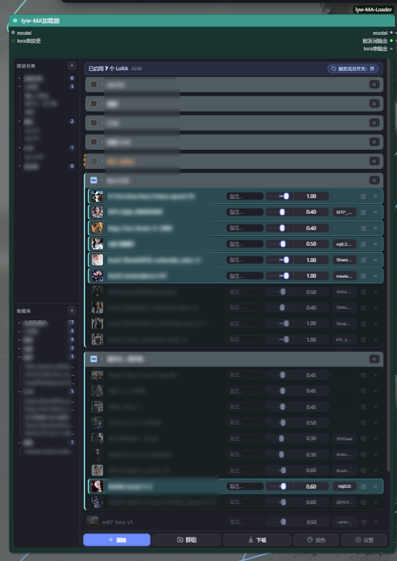

# ComfyUI-lyw-MA-Loader

ComfyUI 的独立可视化 LoRA 加载器：把 LoRA 编成群组、管理预设与收藏、抓取 Civitai 预览图与触发词，并可选与 [Lora Manager](https://github.com/willmiao/ComfyUI-Lora-Manager) 互通。

English: [README.md](README.md)

## 更新介绍

这里只记录重要更新，颜色、文案等小改动不写入。

### 1.0.4

- 设置里新增预设与收藏的导入/导出
- 触发词开关改为右键；多触发词可逐项屏蔽，按钮只预览已启用的词
- 文件夹忽略改为独立眼睛按钮，左键标题改为折叠/展开
- CLIP 权重支持跟随模型权重或独立自定义
- 新增当前工作流全部 LoRA 的一键补全
- 文件夹右键新增「保存为预设组」
- LoRA 添加窗口新增目标群组选择
- 新增布局守护，节点拉宽后内嵌面板不再被压窄
- 布局设置新增「隐藏 CLIP 权重列」选项

### 1.0.3

- 首次发布到 ComfyUI Registry，包含群组、预设、Civitai 信息、Lora Manager 互通、颜色、链式输出和多语言等主要功能

**主节点界面**



**添加 / 替换 LoRA 弹窗**


> 截图为中文界面。节点跟随系统语言：中文系统显示中文，其它系统显示英文。

## 致谢

本插件是在 [ComfyUI-Magic-Assistant](https://github.com/shigjfg/ComfyUI-Magic-Assistant.git) 的基础上修改而来。特别感谢作者 **shigjfg** 提供的基础工作。同时感谢群友 **you** 参与修复、增添功能并提出改进建议。

## 功能

### 可视化 LoRA 列表

每一行包含缩略图、权重滑条、备注输入、触发词按钮和启用开关。点击整行即可决定它是否参与加载，停用后整行变暗。权重、备注和触发词都会存进工作流，所以每个画布各自独立。

### 群组（文件夹）

- 把选中的 LoRA 收进一个群组
- 拖动行或群组标题右侧空白处即可自由排序，**松手位置就是落点**，会显示蓝色插入线
- 把行拖到群组上即可移入组内；拖到列表空白处则移回根列表
- **忽略群组**：组内 LoRA 不再参与加载，但每一行自己的勾选状态原样保留；取消忽略后完全恢复。被忽略的群组也不参与「组成文件夹 / 额外群组」

### 预设与收藏

左侧栏存放预设（多条 LoRA 的快照）和收藏夹。把预设或收藏拖到右侧列表，会精确插到你松开鼠标的位置，不再一律追加到末尾；单击条目仍然是追加到末尾。

### 多选与批量操作

右键任意一行：

| 操作 | 行为 |
|---|---|
| 替换 LoRA | 更换模型文件，保留位置与设置 |
| 复制 LoRA | 把选中行复制到根列表末尾 |
| 组成文件夹 | 把选中行移入新群组（原位置清空） |
| 额外群组 | 把选中行复制进新群组，原条目保留 |
| 爬取信息 | 批量抓取所选行的 Civitai 信息 |
| 颜色设置 | 单行配色 |
| 删除 | 删除该行 |

### Civitai 信息与预览

触发词与预览图按 SHA256 到 Civitai 查询，保存到模型同目录（`<模型>.txt`、`<模型>.png/.jpg/.webp`）以及 `<模型>.metadata.json` 附属文件。内置信息管理弹窗支持：

- 按范围 / 文件夹 / 当前选择批量补全缺失信息
- 重新检查来源、更新已有信息
- **未找到来源**的条目单独归类，不混进补全结果
- 遇到 Civitai 限流会自动暂停，避免反复撞墙

### 与 Lora Manager 互通（可选）

安装了 [Lora Manager](https://github.com/willmiao/ComfyUI-Lora-Manager) 时，复用它的 sidecar 格式和下载接口，两边显示的预览、标题、触发词保持一致；未安装则回退到插件自身的爬取，同样能下载预览图和触发词。

### 颜色设置

单条 LoRA 和单个文件夹都可设配色，每种都有两种模式：

- **跟随全局**：使用全局默认色，全局改动时一起变
- **独立固定**：只用自己的颜色，不受全局改动影响

所选模式随工作流保存。

### 链式输出

`lora串输出` 可以接到下一个加载器。整条链只有末端节点真正应用 LoRA，模型只打一次补丁。`触发词输出` 会输出实际加载成功的 LoRA 的合并触发词。

### 语言

节点标题、端口与弹窗跟随系统语言：`zh-*` 显示中文，其余一律英文。测试时可在浏览器控制台执行 `localStorage.setItem("MPL_LANG", "en")`（或 `"zh"`）强制切换。

### 性能说明

只有「启用且不在忽略群组内」的 LoRA 会被序列化进节点数据，停用和忽略的行完全不会送到后端。LoRA 张量按 `(路径, 权重)` 缓存，每次执行后释放未使用的条目，因此反复调权重不会累积占用。

## 安装

```bash
cd ComfyUI/custom_nodes
git clone https://github.com/shengdaklp99/ComfyUI-lyw-MA-Loader.git
```

重启 ComfyUI，节点位于 **✨ Magic Assistant → lyw-MA加载器**。

依赖：ComfyUI 自带的 `torch`、`numpy`、`Pillow` 即可；`opencv-python` 为可选项，仅用于从视频预览提取首帧。

## 快速上手

1. 添加 **lyw-MA加载器** 并连接 `model`
2. 点底部「添加」加入 LoRA，或从左侧预设/收藏拖入
3. 点行切换是否加载，行内调整权重与备注
4. 右键行进行批量操作
5. 需要触发词就接 `触发词输出`

## 端口说明

| 端口 | 方向 | 说明 |
|---|---|---|
| `model` | 输入 | 要打补丁的模型 |
| `lora串接受` | 输入（可选） | 来自上游加载器的 LoRA 串 |
| `model` | 输出 | 打完补丁的模型 |
| `触发词输出` | 输出 | 已加载 LoRA 的合并触发词 |
| `lora串输出` | 输出 | 交给下一个加载器的 LoRA 串 |

## 常见问题

- **英文系统下节点标题仍是中文**：ComfyUI 在启动时缓存 `/i18n`，重启 ComfyUI 后强制刷新浏览器（Ctrl+Shift+R）
- **排队时报 "Missing LoRA file(s)"**：工作流引用的模型已被删除，节点会在执行前校验
- **预览图不显示**：先跑一次信息管理，或确认预览文件与模型放在同一目录

## 参与

欢迎提 Issue 或 PR。

---

如果这个插件对你有帮助，欢迎点个 ⭐ **Star**，能让更多 ComfyUI 用户找到它。
